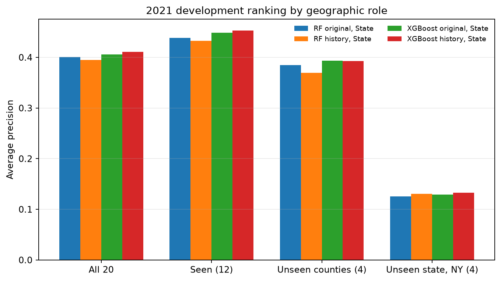
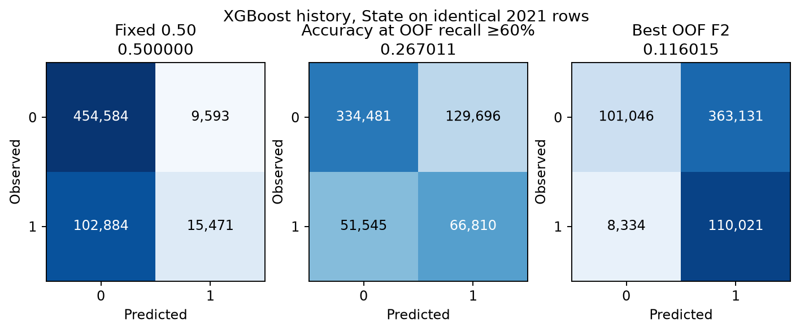

# Random Forest versus XGBoost

The model selection criterion was mean average precision across 2018 H2, 2019, and 2020 with an expanding window and a strict three-hour horizon purge. Each model learned preprocessing and categorical encoders separately in each fold. Original Random Forest predictions and fit evidence were reused after exact key and label alignment. New classifiers were scored on those same observations. The locked 2021 prediction stage ran after the model ranking and cutoff selection.

## Chronological folds

| Variant | Depth limit | 2018 H2 AP | 2019 AP | 2020 AP | Mean AP | Sample SD |
| --- | --- | --- | --- | --- | --- | --- |
| RF original, State | 12 | 0.423192 | 0.440413 | 0.435196 | 0.432933 | 0.008830 |
| RF original, State + FIPS | 12 | 0.455737 | 0.470752 | 0.475653 | 0.467380 | 0.010377 |
| RF history, State | 12 | 0.428861 | 0.440471 | 0.435161 | 0.434831 | 0.005812 |
| RF history, State + FIPS | 12 | 0.455341 | 0.468914 | 0.472265 | 0.465507 | 0.008961 |
| XGBoost original, State | 6 | 0.425369 | 0.443571 | 0.441664 | 0.436868 | 0.010004 |
| XGBoost history, State | 6 | 0.437028 | 0.453743 | 0.450201 | 0.446991 | 0.008808 |

The fixed Random Forest has 100 trees, maximum depth 12, minimum leaf size 10, and seed 17. The CPU XGBoost search used two depth values, 120 histogram-based boosting rounds, learning rate 0.10, seed 17, and two threads. XGBoost builds each tree to improve the current ensemble and evaluates candidate splits in numeric bins. Its minimum child weight limits splits supported by too little loss curvature. The Random Forest averages independently fitted trees. No early stopping was used. These are bounded configurations on this laptop.

| XGBoost candidate | Depth | Mean OOF AP | Sum of fit time |
| --- | --- | --- | --- |
| XGBoost original, State | 4 | 0.435263 | 18.7s |
| XGBoost original, State | 6 | 0.436868 | 21.9s |
| XGBoost history, State | 4 | 0.445778 | 23.1s |
| XGBoost history, State | 6 | 0.446991 | 26.2s |

## Previously consulted 2021 development comparison

| Variant | Decision rule | Cutoff | AP | Accuracy | Recall | Precision | F1 | F2 | Balanced acc. | ROC-AUC | False alarms / 1,000 | TN / FP / FN / TP |
| --- | --- | --- | --- | --- | --- | --- | --- | --- | --- | --- | --- | --- |
| RF original, State | Fixed 0.50 | 0.500000 | 0.400952 | 80.67% | 8.29% | 70.63% | 14.84% | 10.07% | 53.71% | 0.691907 | 7.0 | 460,097/4,080/108,542/9,813 |
| RF original, State | Best OOF F2 | 0.125931 | 0.400952 | 33.75% | 93.69% | 22.66% | 36.50% | 57.59% | 56.08% | 0.691907 | 649.6 | 85,736/378,441/7,464/110,891 |
| RF original, State | Accuracy at OOF recall ≥60% | 0.271216 | 0.400952 | 67.47% | 57.60% | 32.86% | 41.85% | 50.06% | 63.80% | 0.691907 | 239.1 | 324,870/139,307/50,177/68,178 |
| RF original, State + FIPS | Fixed 0.50 | 0.500000 | 0.402954 | 80.59% | 9.27% | 65.85% | 16.26% | 11.20% | 54.02% | 0.685008 | 9.8 | 458,485/5,692/107,380/10,975 |
| RF original, State + FIPS | Best OOF F2 | 0.133317 | 0.402954 | 32.37% | 93.84% | 22.31% | 36.05% | 57.18% | 55.27% | 0.685008 | 663.8 | 77,504/386,673/7,290/111,065 |
| RF original, State + FIPS | Accuracy at OOF recall ≥60% | 0.259589 | 0.402954 | 66.68% | 56.97% | 32.01% | 40.99% | 49.29% | 63.06% | 0.685008 | 245.8 | 320,985/143,192/50,928/67,427 |
| RF history, State | Fixed 0.50 | 0.500000 | 0.394870 | 80.49% | 6.13% | 73.82% | 11.31% | 7.50% | 52.79% | 0.691752 | 4.4 | 461,605/2,572/111,104/7,251 |
| RF history, State | Best OOF F2 | 0.131452 | 0.394870 | 34.43% | 93.54% | 22.83% | 36.70% | 57.76% | 56.45% | 0.691752 | 642.6 | 89,846/374,331/7,641/110,714 |
| RF history, State | Accuracy at OOF recall ≥60% | 0.273473 | 0.394870 | 67.89% | 56.48% | 33.03% | 41.68% | 49.46% | 63.64% | 0.691752 | 232.7 | 328,624/135,553/51,506/66,849 |
| RF history, State + FIPS | Fixed 0.50 | 0.500000 | 0.403314 | 80.42% | 8.28% | 64.05% | 14.66% | 10.03% | 53.55% | 0.692416 | 9.4 | 458,676/5,501/108,556/9,799 |
| RF history, State + FIPS | Best OOF F2 | 0.132056 | 0.403314 | 33.78% | 93.87% | 22.69% | 36.55% | 57.69% | 56.17% | 0.692416 | 649.7 | 85,678/378,499/7,251/111,104 |
| RF history, State + FIPS | Accuracy at OOF recall ≥60% | 0.260133 | 0.403314 | 67.82% | 56.71% | 33.01% | 41.73% | 49.59% | 63.69% | 0.692416 | 233.8 | 327,973/136,204/51,232/67,123 |
| XGBoost original, State | Fixed 0.50 | 0.500000 | 0.406119 | 80.68% | 11.74% | 63.29% | 19.81% | 14.03% | 55.00% | 0.696717 | 13.8 | 456,115/8,062/104,458/13,897 |
| XGBoost original, State | Best OOF F2 | 0.120955 | 0.406119 | 36.44% | 92.41% | 23.24% | 37.14% | 57.92% | 57.29% | 0.696717 | 620.2 | 102,914/361,263/8,988/109,367 |
| XGBoost original, State | Accuracy at OOF recall ≥60% | 0.266304 | 0.406119 | 68.07% | 57.38% | 33.37% | 42.20% | 50.17% | 64.09% | 0.696717 | 232.7 | 328,597/135,580/50,439/67,916 |
| XGBoost history, State | Fixed 0.50 | 0.500000 | 0.411168 | 80.69% | 13.07% | 61.73% | 21.57% | 15.52% | 55.50% | 0.700933 | 16.5 | 454,584/9,593/102,884/15,471 |
| XGBoost history, State | Best OOF F2 | 0.116015 | 0.411168 | 36.23% | 92.96% | 23.25% | 37.20% | 58.12% | 57.36% | 0.700933 | 623.4 | 101,046/363,131/8,334/110,021 |
| XGBoost history, State | Accuracy at OOF recall ≥60% | 0.267011 | 0.411168 | 68.89% | 56.45% | 34.00% | 42.44% | 49.86% | 64.25% | 0.700933 | 222.6 | 334,481/129,696/51,545/66,810 |

The operating candidate uses the highest-accuracy cutoff that attained at least 60% recall on pooled OOF. F2 is a more permissive comparison rule. Average precision summarizes the precision-recall ranking across all cutoffs. ROC-AUC measures how often positives outrank negatives. Group prevalence determines the AP of a constant score and is recorded beside group results.

## Geographic transfer at the operating candidate

| Variant | Group | Rows | Prevalence | AP | Accuracy | Recall | Precision | FP / 1,000 |
| --- | --- | --- | --- | --- | --- | --- | --- | --- |
| RF original, State | Original three | 102,449 | 32.91% | 0.565505 | 62.20% | 72.88% | 45.38% | 288.7 |
| RF original, State | Seen (12) | 364,777 | 23.88% | 0.438562 | 66.32% | 59.62% | 37.19% | 240.4 |
| RF original, State | Unseen counties (4) | 116,528 | 19.79% | 0.384807 | 64.80% | 56.70% | 29.65% | 266.3 |
| RF original, State | Unseen state, NY (4) | 101,227 | 8.09% | 0.125265 | 74.71% | 38.75% | 13.36% | 203.4 |
| RF original, State + FIPS | Original three | 102,449 | 32.91% | 0.566411 | 57.51% | 82.02% | 42.47% | 365.7 |
| RF original, State + FIPS | Seen (12) | 364,777 | 23.88% | 0.450123 | 68.15% | 56.97% | 38.67% | 215.7 |
| RF original, State + FIPS | Unseen counties (4) | 116,528 | 19.79% | 0.381489 | 64.13% | 59.41% | 29.70% | 278.3 |
| RF original, State + FIPS | Unseen state, NY (4) | 101,227 | 8.09% | 0.117135 | 64.29% | 50.11% | 11.35% | 316.7 |
| RF history, State | Original three | 102,449 | 32.91% | 0.554448 | 61.36% | 73.50% | 44.71% | 299.1 |
| RF history, State | Seen (12) | 364,777 | 23.88% | 0.432320 | 66.11% | 58.74% | 36.85% | 240.3 |
| RF history, State | Unseen counties (4) | 116,528 | 19.79% | 0.369440 | 65.00% | 55.20% | 29.48% | 261.3 |
| RF history, State | Unseen state, NY (4) | 101,227 | 8.09% | 0.130348 | 77.62% | 36.13% | 14.52% | 172.2 |
| RF history, State + FIPS | Original three | 102,449 | 32.91% | 0.563315 | 57.20% | 82.35% | 42.29% | 369.9 |
| RF history, State + FIPS | Seen (12) | 364,777 | 23.88% | 0.447091 | 67.86% | 57.53% | 38.44% | 220.0 |
| RF history, State + FIPS | Unseen counties (4) | 116,528 | 19.79% | 0.378098 | 64.59% | 57.94% | 29.75% | 270.8 |
| RF history, State + FIPS | Unseen state, NY (4) | 101,227 | 8.09% | 0.126291 | 71.41% | 44.53% | 13.01% | 241.1 |
| XGBoost original, State | Original three | 102,449 | 32.91% | 0.577353 | 63.66% | 71.27% | 46.60% | 268.8 |
| XGBoost original, State | Seen (12) | 364,777 | 23.88% | 0.448773 | 67.27% | 59.09% | 38.06% | 229.6 |
| XGBoost original, State | Unseen counties (4) | 116,528 | 19.79% | 0.393584 | 65.92% | 56.25% | 30.46% | 254.2 |
| XGBoost original, State | Unseen state, NY (4) | 101,227 | 8.09% | 0.129296 | 73.41% | 42.40% | 13.53% | 219.3 |
| XGBoost history, State | Original three | 102,449 | 32.91% | 0.577422 | 63.21% | 71.91% | 46.22% | 275.5 |
| XGBoost history, State | Seen (12) | 364,777 | 23.88% | 0.452627 | 67.61% | 58.45% | 38.31% | 224.7 |
| XGBoost history, State | Unseen counties (4) | 116,528 | 19.79% | 0.392429 | 67.08% | 54.61% | 31.11% | 239.4 |
| XGBoost history, State | Unseen state, NY (4) | 101,227 | 8.09% | 0.132975 | 75.59% | 40.36% | 14.29% | 195.8 |

All 20 county metrics, all six operating cutoffs and confusion counts are in [metrics_2021.csv](model_results/metrics_2021.csv). Compare models within the same group because event prevalence and county mix change AP. New York is one unseen state. The geographic populations and 2021 have already been consulted during development.

## Runtime, memory, and generalization gap

| Variant | Full fit time | Fit peak RSS GiB | Minimum available GiB | Trees | Nodes | Training AP | Train minus 2021 AP |
| --- | --- | --- | --- | --- | --- | --- | --- |
| RF original, State | 141.9s | 1.63 | 2.73 | 100 | 423,114 | 0.479893 | +0.078940 |
| RF original, State + FIPS | 117.5s | 1.64 | 2.36 | 100 | 344,726 | 0.509726 | +0.106773 |
| RF history, State | 198.9s | 1.76 | 2.43 | 100 | 429,896 | 0.490111 | +0.095241 |
| RF history, State + FIPS | 182.8s | 1.79 | 3.42 | 100 | 374,852 | 0.517323 | +0.114009 |
| XGBoost original, State | 18.9s | 1.37 | 3.82 | 120 | 13,826 | 0.469415 | +0.063296 |
| XGBoost history, State | 13.5s | 1.79 | 3.71 | 120 | 14,116 | 0.483220 | +0.072052 |

RSS is the sampled peak Python process working set. The archived forest used its original measurement, so process overhead differs. The fit includes imputation, scaling, geography encoding and estimator training. A training-versus-2021 gap combines overfitting with year and geographic composition changes. A fresh Python process reproduced 585 stored scores per new pipeline and verified 8 archived hashes for the official notebooks and artifacts.

## Use of hour_utc

| Model | Hour rank | Hour AP drop | Largest AP drops |
| --- | --- | --- | --- |
| RF original, State | 1 | +0.113023 | hour_utc +0.1130, customers_out_t +0.0272, weekday_utc +0.0200, rolling_variance_60m +0.0102 |
| XGBoost history, State | 1 | +0.123691 | hour_utc +0.1237, customers_out_t +0.0384, weekday_utc +0.0216, rolling_max_180m +0.0153 |

The same deterministic 20,000-row 2021 sample was scored with each numeric feature permuted three times. A drop in AP means the fitted model relied on that feature in the diagnostic. Correlation among historical features can spread measured importance across several columns. This is a post-selection association check.

