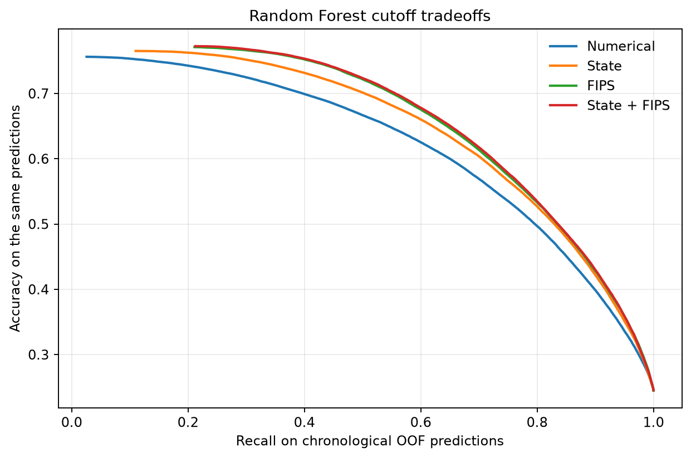

# Threshold diagnosis

The four existing 100-tree Random Forests scored 890,035 genuine out-of-fold observations in purged chronological folds (181,267 in 2018 H2, 358,402 in 2019, and 350,366 in 2020). Every rule below was selected on those scores and saved before the 582,532 archived 2021 scores were opened. There was no geographical holdout fitting. The 2021 positive prevalence was 20.32%, giving an always-negative accuracy of 79.68% with zero recall.

A positive prediction requires a probability score strictly greater than the cutoff. Forest probabilities average positive-class proportions across trees. The observed positive-score distribution, including the median 0.309 for State + FIPS, clusters below 0.50. That rule called only 16,667 of 582,532 rows positive and missed 107,380 of the 118,355 escalations. Score distributions can also shift across time or locations. A score is not a calibrated estimate of operational risk on the evidence available here.

| Positive OOF scores | 10th pct. | 25th pct. | Median | 75th pct. | 90th pct. |
| --- | --- | --- | --- | --- | --- |
| Numerical | 0.152 | 0.210 | 0.294 | 0.369 | 0.421 |
| State | 0.145 | 0.205 | 0.313 | 0.413 | 0.484 |
| FIPS | 0.153 | 0.202 | 0.300 | 0.425 | 0.528 |
| State + FIPS | 0.148 | 0.202 | 0.309 | 0.435 | 0.527 |

## Transfer to 2021

| Forest | OOF objective | Cutoff | OOF acc. | OOF recall | 2021 acc. | 2021 recall | 2021 precision | 2021 FP / 1,000 |
| --- | --- | --- | --- | --- | --- | --- | --- | --- |
| Numerical | Fixed 0.50 | 0.500000 | 75.58% | 0.65% | 79.70% | 0.47% | 53.91% | 0.8 |
| Numerical | Best OOF F2 | 0.118247 | 32.07% | 96.17% | 27.89% | 96.51% | 21.54% | 714.0 |
| Numerical | Best OOF balanced accuracy | 0.253456 | 61.13% | 62.87% | 62.71% | 60.62% | 29.61% | 292.8 |
| Numerical | Accuracy at OOF recall ≥50% | 0.293544 | 66.68% | 50.00% | 69.45% | 46.56% | 32.44% | 197.0 |
| Numerical | Accuracy at OOF recall ≥60% | 0.263051 | 62.53% | 60.00% | 64.35% | 57.72% | 30.24% | 270.6 |
| Numerical | Accuracy at OOF recall ≥70% | 0.227490 | 56.92% | 70.00% | 57.98% | 68.18% | 28.04% | 355.5 |
| State | Fixed 0.50 | 0.500000 | 76.51% | 8.92% | 80.67% | 8.29% | 70.63% | 7.0 |
| State | Best OOF F2 | 0.125931 | 37.53% | 93.46% | 33.75% | 93.69% | 22.66% | 649.6 |
| State | Best OOF balanced accuracy | 0.263823 | 65.25% | 61.58% | 66.54% | 59.28% | 32.35% | 251.9 |
| State | Accuracy at OOF recall ≥50% | 0.313364 | 70.14% | 50.00% | 72.58% | 46.60% | 36.36% | 165.7 |
| State | Accuracy at OOF recall ≥60% | 0.271216 | 66.02% | 60.00% | 67.47% | 57.60% | 32.86% | 239.1 |
| State | Accuracy at OOF recall ≥70% | 0.225004 | 60.37% | 70.00% | 61.10% | 67.79% | 29.86% | 323.6 |
| FIPS | Fixed 0.50 | 0.500000 | 76.92% | 12.82% | 80.40% | 8.42% | 63.30% | 9.9 |
| FIPS | Best OOF F2 | 0.130184 | 37.01% | 94.30% | 33.48% | 93.57% | 22.57% | 652.1 |
| FIPS | Best OOF balanced accuracy | 0.270083 | 69.20% | 56.84% | 70.40% | 50.59% | 34.45% | 195.6 |
| FIPS | Accuracy at OOF recall ≥50% | 0.299787 | 72.19% | 50.00% | 75.25% | 39.94% | 39.27% | 125.5 |
| FIPS | Accuracy at OOF recall ≥60% | 0.256326 | 67.55% | 60.00% | 67.51% | 55.42% | 32.46% | 234.3 |
| FIPS | Accuracy at OOF recall ≥70% | 0.217536 | 61.36% | 70.00% | 60.26% | 67.49% | 29.27% | 331.3 |
| State + FIPS | Fixed 0.50 | 0.500000 | 76.98% | 13.17% | 80.59% | 9.27% | 65.85% | 9.8 |
| State + FIPS | Best OOF F2 | 0.133317 | 39.15% | 92.91% | 32.37% | 93.84% | 22.31% | 663.8 |
| State + FIPS | Best OOF balanced accuracy | 0.270007 | 68.93% | 57.91% | 68.06% | 54.86% | 32.86% | 227.7 |
| State + FIPS | Accuracy at OOF recall ≥50% | 0.309165 | 72.35% | 50.00% | 74.72% | 42.82% | 38.90% | 136.6 |
| State + FIPS | Accuracy at OOF recall ≥60% | 0.259589 | 67.82% | 60.00% | 66.68% | 56.97% | 32.01% | 245.8 |
| State + FIPS | Accuracy at OOF recall ≥70% | 0.219185 | 61.75% | 70.00% | 58.15% | 67.97% | 28.09% | 353.5 |

For State + FIPS, the 60% OOF recall rule moved 2021 recall by +47.70 percentage points and accuracy by -13.91 points. It caught 56,452 additional escalations and produced 137,500 additional false alarms. The F2 cutoff reached 93.84% recall with 663.8 false alarms per 1,000 observations. The 60% OOF target is a selection constraint on historical folds and does not guarantee 60% recall on future data.

F2 weights recall more than precision. Balanced accuracy averages recall for escalation and non-escalation. For the constrained cutoffs, the script evaluates every attainable grouping of equal scores and finds the highest-accuracy point satisfying the recall goal. Metric ties favor a higher cutoff. The Pareto frontier contains only points for which increasing recall requires giving up accuracy. False alarms are false positives divided by all observations, multiplied by 1,000. Changing a cutoff preserves the scores and ranking metrics.

[Per-fold, pooled and 2021 metrics including all county groups](threshold_results/metrics.csv) · [Frozen cutoffs](threshold_results/frozen_thresholds.json)
