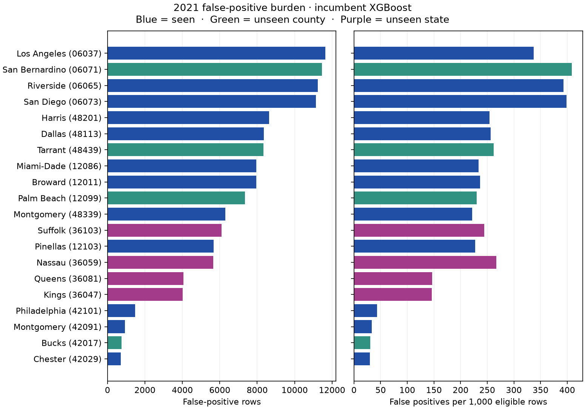

# Where false-positive rows concentrate

California’s four counties produced **45,467 false-positive rows**, 35.1% of all 2021 false positives from the incumbent longer-history XGBoost. They made up 20.4% of eligible development rows. Los Angeles had the highest count. San Bernardino had the highest burden per 1,000 eligible rows, and Los Angeles had the highest false-positive rate among negatives.

Each entry is an eligible 15-minute county observation. Neighboring rows can share an outage and their three-hour label windows can overlap. The false-positive counts measure rows the model flagged incorrectly. The number of emergency alerts or incidents cannot be recovered from these counts.

## Geographic groups at the incumbent cutoff

The incumbent cutoff was selected in the previous OOF experiment. It yields the same 2021 decisions as the diagnostic’s 60% OOF rule. State was encoded during training. New York’s four counties were absent from training, so they have no learned New York State indicator. The other four unseen counties are in states the model saw during training.

| Group | Rows | Positive prevalence | Recall | Precision | AP | ROC AUC | False positives | FP / 1,000 | FPR |
| --- | ---: | ---: | ---: | ---: | ---: | ---: | ---: | ---: | ---: | ---: |
| All counties | 582,532 | 20.32% | 56.45% | 34.00% | 0.411168 | 0.700933 | 129,696 | 222.6 | 27.94% |
| Seen counties (12) | 364,777 | 23.88% | 58.45% | 38.31% | 0.452627 | 0.703529 | 81,978 | 224.7 | 29.52% |
| Unseen counties in represented states (4) | 116,528 | 19.79% | 54.61% | 31.11% | 0.392429 | 0.678388 | 27,893 | 239.4 | 29.84% |
| Unseen New York counties (4) | 101,227 | 8.09% | 40.36% | 14.29% | 0.132975 | 0.646752 | 19,825 | 195.8 | 21.31% |

New York’s lower prevalence accounts for part of the precision gap. Fewer positives are available among flagged rows, even though New York has the lowest FPR of the three groups. There is also evidence of weaker ranking. ROC AUC declines from 0.704 in seen counties to 0.647 in New York, and AP exceeds prevalence by 0.052 in New York versus 0.214 in seen counties. Similar FPRs in seen counties and other unseen counties accompany a 7.20-point precision gap, lower prevalence and lower ranking quality. These comparisons describe transfer in this cohort. New York’s unknown State encoding, outage and reporting characteristics, and any differences in the composition of eligible observations could all contribute.

## Individual counties

The table is sorted by false-positive row count. The FIPS code identifies counties with the same name. `Seen` designates training counties, `Unseen county` holds out the county within a represented state, and `Unseen state` holds out New York.

| County | FIPS | Group | Rows | Prev. | Recall | Precision | AP | FP rows | FP / 1,000 | FPR |
| --- | --- | --- | ---: | ---: | ---: | ---: | ---: | ---: | ---: | ---: | ---: |
| Los Angeles, CA | 06037 | Seen | 34,476 | 42.99% | 85.13% | 52.03% | 0.6900 | 11,633 | 337.4 | 59.18% |
| San Bernardino, CA | 06071 | Unseen county | 28,079 | 27.20% | 79.89% | 34.73% | 0.5714 | 11,469 | 408.5 | 56.11% |
| Riverside, CA | 06065 | Seen | 28,608 | 27.29% | 75.39% | 34.37% | 0.5166 | 11,238 | 392.8 | 54.03% |
| San Diego, CA | 06073 | Seen | 27,894 | 29.55% | 74.05% | 35.43% | 0.4753 | 11,127 | 398.9 | 56.63% |
| Harris, TX | 48201 | Seen | 33,916 | 25.91% | 62.26% | 38.80% | 0.4512 | 8,628 | 254.4 | 34.33% |
| Dallas, TX | 48113 | Seen | 32,556 | 25.88% | 55.67% | 35.97% | 0.3783 | 8,347 | 256.4 | 34.59% |
| Tarrant, TX | 48439 | Unseen county | 31,779 | 22.27% | 48.47% | 29.16% | 0.2982 | 8,333 | 262.2 | 33.73% |
| Miami-Dade, FL | 12086 | Seen | 34,057 | 29.69% | 60.93% | 43.64% | 0.4708 | 7,959 | 233.7 | 33.24% |
| Broward, FL | 12011 | Seen | 33,576 | 21.52% | 59.81% | 35.24% | 0.3758 | 7,942 | 236.5 | 30.14% |
| Palm Beach, FL | 12099 | Unseen county | 31,857 | 17.21% | 51.21% | 27.67% | 0.2741 | 7,339 | 230.4 | 27.82% |
| Montgomery, TX | 48339 | Seen | 28,485 | 20.38% | 46.69% | 30.07% | 0.2973 | 6,306 | 221.4 | 27.81% |
| Suffolk, NY | 36103 | Unseen state | 24,935 | 13.64% | 44.18% | 19.77% | 0.1936 | 6,097 | 244.5 | 28.31% |
| Pinellas, FL | 12103 | Seen | 24,971 | 17.57% | 42.68% | 24.80% | 0.2379 | 5,680 | 227.5 | 27.60% |
| Nassau, NY | 36059 | Unseen state | 21,173 | 11.38% | 45.15% | 16.13% | 0.1577 | 5,657 | 267.2 | 30.15% |
| Queens, NY | 36081 | Unseen state | 27,601 | 6.03% | 29.63% | 10.85% | 0.0908 | 4,050 | 146.7 | 15.61% |
| Kings, NY | 36047 | Unseen state | 27,518 | 2.61% | 31.06% | 5.25% | 0.0490 | 4,021 | 146.1 | 15.00% |
| Philadelphia, PA | 42101 | Seen | 34,438 | 14.78% | 11.53% | 28.41% | 0.2293 | 1,479 | 42.9 | 5.04% |
| Montgomery, PA | 42091 | Seen | 27,595 | 12.88% | 8.89% | 25.48% | 0.1940 | 924 | 33.5 | 3.84% |
| Bucks, PA | 42017 | Unseen county | 24,813 | 11.56% | 8.92% | 25.40% | 0.1896 | 752 | 30.3 | 3.43% |
| Chester, PA | 42029 | Seen | 24,205 | 11.73% | 6.02% | 19.30% | 0.1757 | 715 | 29.5 | 3.35% |

Los Angeles has AP of 0.690 and 85.13% recall, alongside a 59.18% FPR. The high false-positive count there is consistent with many scores crossing the global cutoff despite relatively strong within-county ranking and high prevalence. San Bernardino has a similar high-recall, high-burden profile even though its county was unseen. Pennsylvania’s four counties have 6.02% to 11.53% recall and low FPRs. The global cutoff flags very few rows there. Taken together, these patterns show how one threshold can behave very differently by geography.

Kings has the lowest precision and prevalence. Its ROC AUC is 0.676, while only 2.61% of rows are positive. Nassau has a higher prevalence but a weaker ROC AUC of 0.611 and the highest New York burden per 1,000 rows. Suffolk has the largest New York count. In Kings and Queens the model’s highest mean scores occur about eight hours before their observed prevalence peaks. The mismatch is evidence of an imperfect transfer of the learned hourly pattern. Reporting schedules or differences in outage behavior are plausible explanations that the available data cannot distinguish.

[All five models, every group, and all three OOF rules](results/development_metrics.csv) · [Hourly county evidence](results/hourly_metrics.csv) · [Hour ablation](HOUR_FEATURE_ANALYSIS.md)
