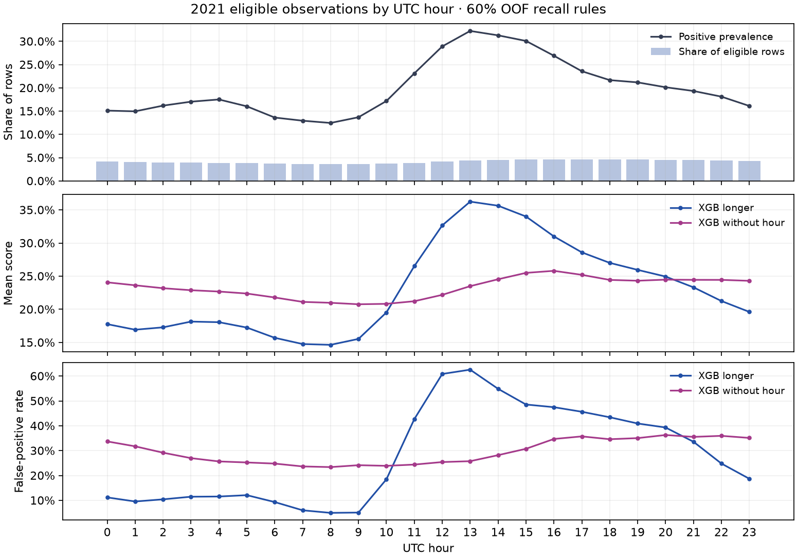
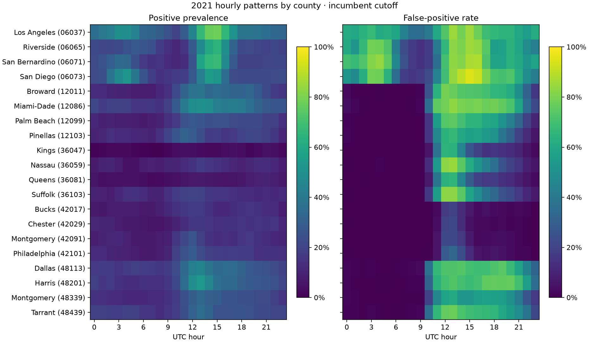

# Does `hour_utc` help predict escalation?

**Yes, for the recorded escalation target on this cohort.** Excluding `hour_utc` reduced average precision in all three chronological folds and reduced 2021 AP from 0.411168 to 0.336766. The hourly patterns also coincide with changes in reporting coverage. This experiment can establish predictive value for the labels in these records. Determining how much of that value comes from physical outage behavior versus reporting cadence requires independently timed outage or reporting events.

## Controlled comparison

The full model uses the archived longer-history State predictions. The ablation fitted the same XGBoost settings with `hour_utc` removed from the numeric input list. Both use depth 6, 120 boosting rounds, the CPU histogram method, a learning rate of 0.10, seed 17, two threads, fold-fitted median imputation and scaling, and the same State encoding. The exact cohort, feature order for retained columns, target labels, and expanding and purged training folds were reused. The final ablation fit uses all 1,053,328 training rows. The two models’ separate operating cutoffs were each selected on pooled OOF scores. [Configuration and input hashes](results/run_evidence.json) · [Frozen cutoffs](results/frozen_thresholds.json)

| Evaluation period | Full model AP | Without hour AP | AP lost when hour is removed |
| --- | ---: | ---: | ---: |
| 2018 H2 OOF | 0.437028 | 0.362594 | 0.074434 |
| 2019 OOF | 0.453743 | 0.372805 | 0.080938 |
| 2020 OOF | 0.450201 | 0.376993 | 0.073209 |
| Pooled OOF | 0.447540 | 0.371272 | 0.076268 |
| 2021 development | 0.411168 | 0.336766 | 0.074402 |

The paired loss in fold AP measures how much ranking quality dropped when the model had to learn without the feature. It is consistent across time. The archived 2021 permutation test on 20,000 rows lowered AP by 0.123691 on average. A second shuffle that preserved each county-month’s mix of hours lowered AP by 0.125528 on the same sample, with drops from 0.122529 to 0.128662 across three seeds. That shows reliance beyond differences in which counties and months appear at which hours. Shuffling can break natural relationships between hour and other features, so the refit is the stronger measure of the feature’s contribution. [Archived shuffle](results/archived_hour_permutation.json) · [County-month shuffle](results/hour_conditional_permutation.csv)

## Frozen rules in 2021

| OOF recall target | Model | Actual recall | Precision | Accuracy | FP / 1,000 | FPR |
| --- | --- | ---: | ---: | ---: | ---: | ---: |
| 40% | Full | 35.17% | 42.20% | 77.04% | 97.9 | 12.28% |
| 40% | Without hour | 32.98% | 36.39% | 74.67% | 117.1 | 14.69% |
| 50% | Full | 45.73% | 37.59% | 73.55% | 154.3 | 19.36% |
| 50% | Without hour | 42.88% | 33.68% | 71.24% | 171.5 | 21.53% |
| 60% | Full | 56.45% | 34.00% | 68.89% | 222.6 | 27.94% |
| 60% | Without hour | 53.38% | 31.30% | 66.73% | 238.0 | 29.87% |

At a descriptive 60% actual recall coordinate on the 2021 curve, the full model had 33.03% precision and the ablation had 29.95%. The full model also led at 40% and 50% actual recall. At the frozen 60% OOF rules, removing hour created 8,949 more false-positive rows and caught 3,634 fewer positive rows overall. [Matched-recall data](results/development_matched_recall.csv)

## What the model learns by hour

The full model’s highest hourly mean score and false-positive rate both occurred at 13:00 UTC. Its mean score there was 0.363, including an average of 0.326 on actual negative rows. At 08:00 UTC the corresponding scores were 0.146 and 0.142. Recorded escalation prevalence also rose from 12.47% at 08:00 to 32.24% at 13:00, while the false-positive rate rose from 4.97% to 62.58%. The model’s FPR peaked at 13:00 in all three OOF folds. The same five UTC hours from 12:00 through 16:59 account for 38.3% of its 2021 false-positive rows.

The hour-omitted model’s scores and errors were flatter across the day. At 08:00 and 13:00 its mean scores were 0.210 and 0.235, and its FPR was 23.39% and 25.76%. It reduced the midday concentration while increasing false positives overall and weakening the ranking. Each model uses its own frozen 60% OOF rule in the plot.

The average three-hour reporting coverage, measured as observed slots divided by 13, was lowest at 13:00 UTC in every OOF fold and in 2021. In 2021 it reached 92.67% at that hour and 99.29% at 22:00. The share of eligible rows per hour ranged from 3.64% to 4.63%. Eligibility requires an active outage and all future label slots, so eligible row volume reflects both outage activity and which reports are available. Coverage is a reporting proxy within the eligible cohort.

| State | Peak 2021 escalation prevalence | Peak 2021 incumbent FPR |
| --- | ---: | ---: |
| California | 66.00% at 15:00 | 89.05% at 15:00 |
| Florida | 35.96% at 12:00 | 74.56% at 13:00 |
| New York | 11.89% at 13:00 | 73.44% at 13:00 |
| Pennsylvania | 22.81% at 12:00 | 24.11% at 13:00 |
| Texas | 42.06% at 13:00 | 70.73% at 13:00 |

In Kings and Queens, the highest observed prevalence was around 21:00 UTC, while the highest mean score was around 13:00. In Los Angeles, coverage was at least 99.4% at every hour, while prevalence and false-positive rates still varied widely. These observations support both a repeatable association with recorded escalations and a risk of transferring the wrong hourly pattern to some counties. They leave the causal role of reporting schedules open. [State and county hourly results](results/hourly_metrics.csv)

## Geographic transfer

Keeping hour improved AP by 0.081389 in seen counties and 0.095727 in unseen counties within represented states. In unseen New York, AP was nearly flat (0.132975 with hour and 0.133315 without it). The ablation’s New York precision rose from 14.29% to 14.95% at the frozen 60% OOF rule, and its recall fell from 40.36% to 31.54%. At the descriptive 40%, 50% and 60% New York recall coordinates, keeping hour gave higher precision by 0.36, 0.42 and 0.47 percentage points. That is mixed transfer evidence from one state. Kings was a local exception at the frozen rule, with equal recall at 31.06%, precision rising from 5.25% to 7.64%, and fewer false-positive rows after omitting hour. [Geographic results](GEOGRAPHIC_ERRORS.md)
