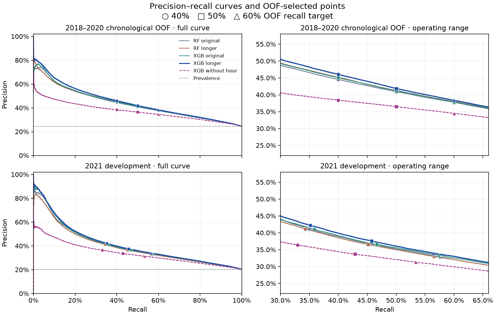

# Precision and recall on identical observations

**Longer-history XGBoost has the highest precision at comparable recall.** It led all four archived State-encoded models at the three OOF recall targets. At the 60% target in 2021, it was within 0.04 percentage points of the longer-history forest’s recall and gained 0.97 points of precision. At the same cutoffs it produced 5,857 fewer false-positive rows and detected 39 fewer positive rows than that forest.

## Threshold selection

All models scored the same 890,035 chronological out-of-fold (OOF) observations from 2018 H2, 2019 and 2020. An OOF score comes from a model fitted on earlier observations, with a three-hour gap to keep label windows from crossing the fold boundary. The diagnostic sorted the pooled scores and took the highest cutoff that yielded at least 40%, 50%, or 60% recall. This gives the smallest number of flagged rows that achieves each goal. Prediction uses `score > cutoff`. Equal scores move together, and the saved cutoff is the next representable `float64` below the last included score.

The cutoffs were saved before opening the 2021 scores. The same cutoffs were then applied to the same 582,532 previously consulted 2021 development observations, including 118,355 positive rows. All comparisons check county FIPS, UTC timestamp and label in order. Positive prevalence was 24.45% in pooled OOF and 20.32% in 2021. Full-precision cutoffs are in [frozen_thresholds.json](results/frozen_thresholds.json).

## Pooled OOF results

Actual OOF recall rounds to the target in every row. All models use State encoding. RF means Random Forest and XGB means XGBoost. The hour-omitted model is in the [feature analysis](HOUR_FEATURE_ANALYSIS.md).

| Model | Recall target | Cutoff | Precision | Accuracy | F1 | F2 | Balanced accuracy | AP | FP / 1,000 | FPR |
| --- | ---: | ---: | ---: | ---: | ---: | ---: | ---: | ---: | ---: | ---: |
| RF original | 40% | 0.354085 | 44.56% | 73.16% | 42.16% | 40.84% | 61.94% | 0.433431 | 121.7 | 16.11% |
| RF longer | 40% | 0.350613 | 45.21% | 73.47% | 42.44% | 40.94% | 62.15% | 0.435438 | 118.6 | 15.69% |
| XGB original | 40% | 0.361800 | 45.10% | 73.42% | 42.40% | 40.93% | 62.12% | 0.437441 | 119.1 | 15.76% |
| XGB longer | 40% | 0.362482 | **46.07%** | 73.88% | 42.82% | 41.08% | 62.42% | 0.447540 | 114.5 | 15.16% |
| RF original | 50% | 0.313364 | 40.95% | 70.14% | 45.02% | 47.88% | 63.33% | 0.433431 | 176.3 | 23.34% |
| RF longer | 50% | 0.314646 | 41.32% | 70.41% | 45.25% | 47.98% | 63.51% | 0.435438 | 173.7 | 22.99% |
| XGB original | 50% | 0.312410 | 41.25% | 70.36% | 45.21% | 47.97% | 63.48% | 0.437441 | 174.1 | 23.05% |
| XGB longer | 50% | 0.312805 | **41.88%** | 70.80% | 45.58% | 48.13% | 63.77% | 0.447540 | 169.7 | 22.46% |
| RF original | 60% | 0.271216 | 37.75% | 66.02% | 46.34% | 53.67% | 63.99% | 0.433431 | 241.9 | 32.03% |
| RF longer | 60% | 0.273473 | 38.01% | 66.29% | 46.54% | 53.78% | 64.17% | 0.435438 | 239.2 | 31.67% |
| XGB original | 60% | 0.266305 | 37.93% | 66.21% | 46.48% | 53.75% | 64.11% | 0.437441 | 240.1 | 31.78% |
| XGB longer | 60% | 0.267012 | **38.38%** | 66.66% | 46.82% | 53.93% | 64.41% | 0.447540 | 235.5 | 31.18% |

## 2021 development results at the frozen cutoffs

| Model | OOF target | Actual recall | Precision | Accuracy | F1 | F2 | Balanced accuracy | AP | FP / 1,000 | FPR |
| --- | ---: | ---: | ---: | ---: | ---: | ---: | ---: | ---: | ---: | ---: |
| RF original | 40% | 34.97% | 41.15% | 76.63% | 37.81% | 36.05% | 61.11% | 0.400952 | 101.6 | 12.75% |
| RF longer | 40% | 34.33% | 41.13% | 76.68% | 37.43% | 35.51% | 60.90% | 0.394870 | 99.8 | 12.53% |
| XGB original | 40% | 35.86% | 41.02% | 76.49% | 38.27% | 36.79% | 61.36% | 0.406119 | 104.7 | 13.15% |
| XGB longer | 40% | 35.17% | **42.20%** | 77.04% | 38.36% | 36.38% | 61.44% | 0.411168 | 97.9 | 12.28% |
| RF original | 50% | 46.60% | 36.36% | 72.58% | 40.85% | 44.12% | 62.90% | 0.400952 | 165.7 | 20.79% |
| RF longer | 50% | 45.13% | 36.54% | 72.93% | 40.38% | 43.10% | 62.57% | 0.394870 | 159.2 | 19.98% |
| XGB original | 50% | 46.68% | 36.55% | 72.70% | 41.00% | 44.23% | 63.01% | 0.406119 | 164.6 | 20.66% |
| XGB longer | 50% | 45.73% | **37.59%** | 73.55% | 41.27% | 43.84% | 63.19% | 0.411168 | 154.3 | 19.36% |
| RF original | 60% | 57.60% | 32.86% | 67.47% | 41.85% | 50.06% | 63.80% | 0.400952 | 239.1 | 30.01% |
| RF longer | 60% | 56.48% | 33.03% | 67.89% | 41.68% | 49.46% | 63.64% | 0.394870 | 232.7 | 29.20% |
| XGB original | 60% | 57.38% | 33.37% | 68.07% | 42.20% | 50.17% | 64.09% | 0.406119 | 232.7 | 29.21% |
| XGB longer | 60% | 56.45% | **34.00%** | 68.89% | 42.44% | 49.86% | 64.25% | 0.411168 | 222.6 | 27.94% |

Precision is the share of flagged rows that are positive. Recall is the share of positive rows that are flagged. F1 gives precision and recall equal weight. F2 favors recall. Balanced accuracy averages recall and the true-negative rate. False positives per 1,000 divides the false-positive count by all rows. FPR divides by actual negatives only. Average precision (AP) summarizes the ranking across score cutoffs and stays fixed as the operating cutoff changes. [scikit-learn AP definition](https://scikit-learn.org/stable/modules/generated/sklearn.metrics.average_precision_score.html)

The 2021 curve also supports the ranking result when recall is held at fixed coordinates. At 40%, 50% and 60% actual recall, longer-history XGBoost has 39.90%, 36.06% and 33.03% precision. The better of the two forests has 38.90%, 35.24% and 32.11% at those coordinates. These are descriptive readings of the 2021 curves. The table above uses only the frozen OOF cutoffs. [Matched-recall curve values](results/development_matched_recall.csv)

Adjacent 15-minute rows can come from the same outage and share label windows. The measured differences describe this development cohort. Statistical inference about new outages would need to account for that dependence.

The **60% OOF target is the strongest recall-preserving choice among the three tested**. It gives the leading model its highest OOF F1, F2 and balanced accuracy of the three rules. The stricter 50% OOF rule raised its 2021 precision by 3.59 points and eliminated 68.4 false-positive rows per 1,000, while losing 10.71 points of recall and 12,681 detected positive rows. The stricter 40% rule lost 21.28 points of recall. The prior incumbent cutoff and the new 60% rule produced identical 2021 decisions by count. A cutoff alone did not deliver a higher-precision operating point with comparable recall among the tested rules.

[All OOF metrics, including individual folds](results/oof_metrics.csv) · [All 2021 metrics](results/development_metrics.csv)
